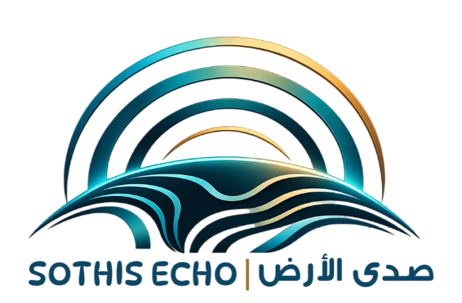
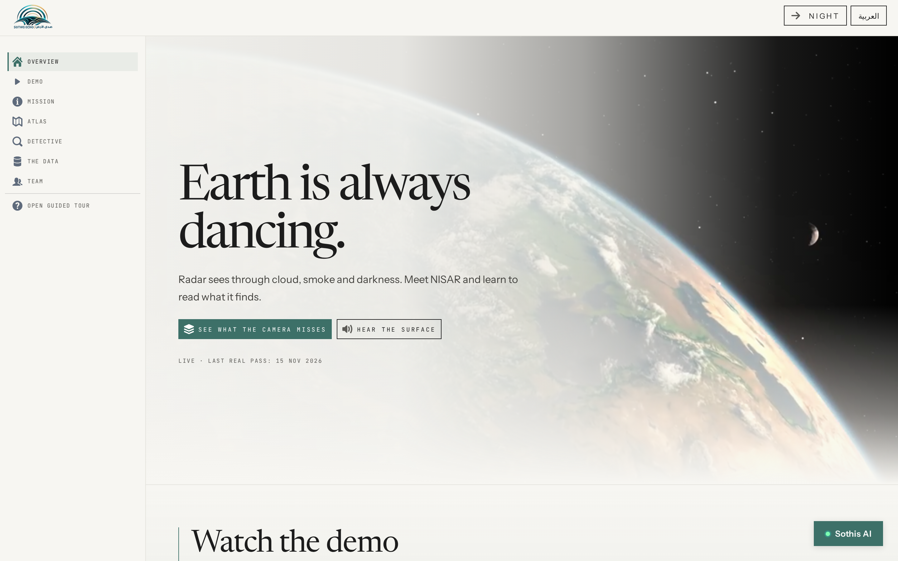
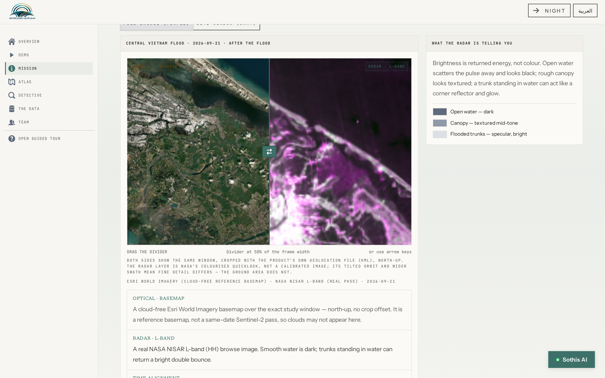
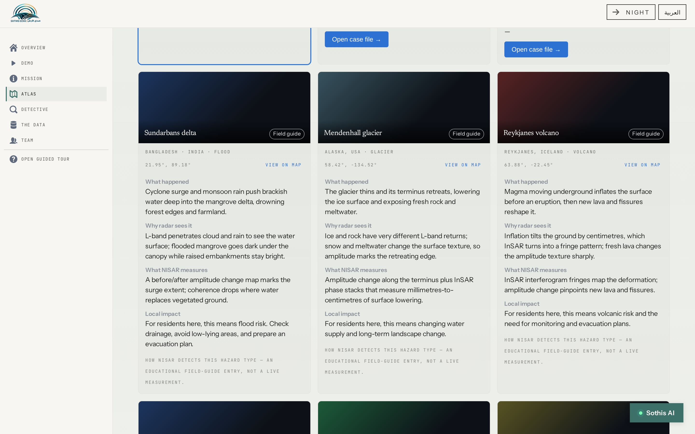
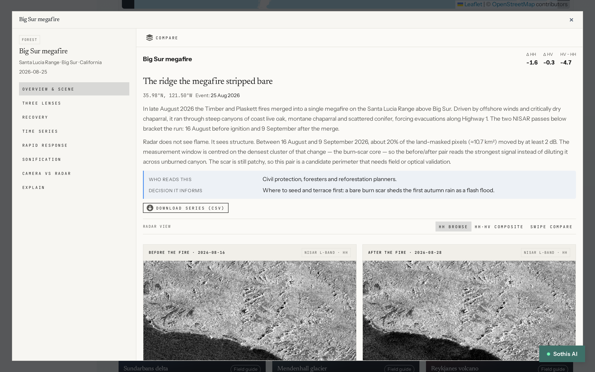
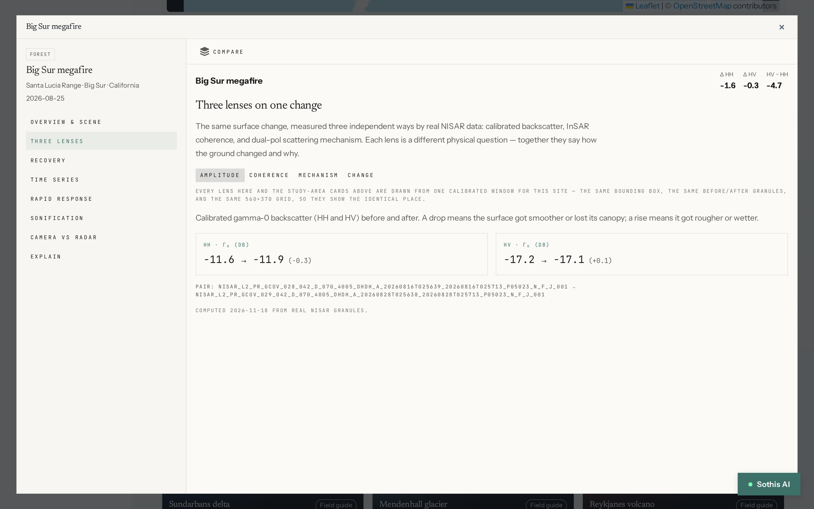
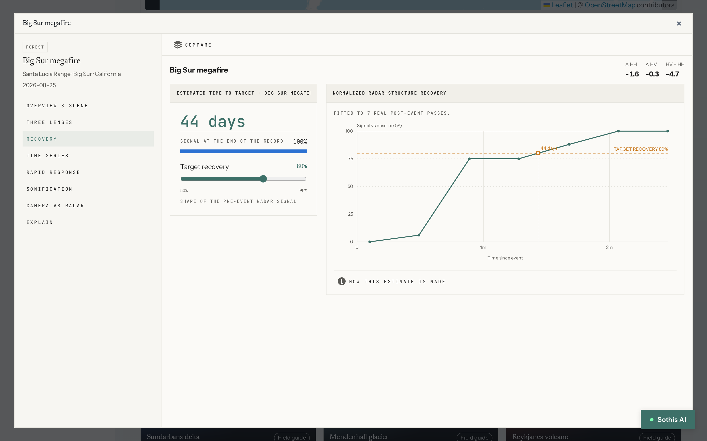
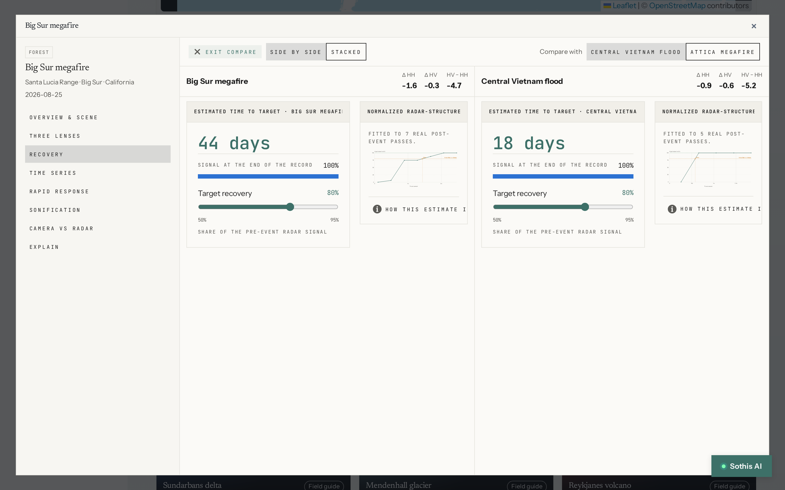
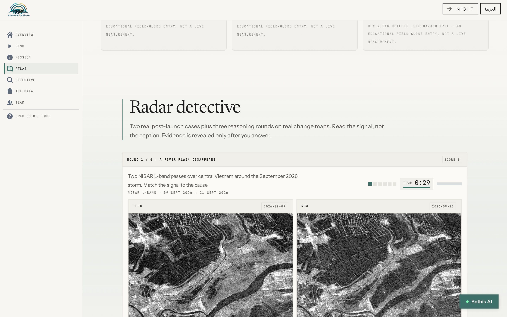

<div align="center">



# Sothis Echo

### Radar stories of a changing Earth — an interactive NISAR mission explorer

> **A camera stops at cloud. Radar doesn't.** Sothis Echo is a bilingual, data-honest explorer that shows how **NASA NISAR L-band radar** sees the changes an optical camera misses — through three real 2026 events, with every number computed from real satellite granules.

[](https://sothisecho.vercel.app)
[](./LICENSE)
[](./CONTRIBUTING.md)

[](https://react.dev)
[](https://vitejs.dev)
[](https://nodejs.org)
[](https://sothisecho.vercel.app)
[](https://nisar.jpl.nasa.gov)

</div>

---

**Sothis Echo** turns raw **NISAR L-band** data into a story you can see, hear and question. It follows four measured 2026 events — the **Big Sur megafire** (California), the **Attica megafire** (Greece), the **Central Vietnam flood** and the **Limpopo floods** (Southern Africa) — and lets you open any of them as a full-screen **case file**, then **compare two places side by side** with a single click.

> **Live:** <https://sothisecho.vercel.app> · Built for the **NASA Space Apps Challenge**.

<details open>
<summary><strong>Table of contents</strong></summary>

- [A quick tour](#a-quick-tour-screenshots-from-the-live-site)
- [Why this project](#why-this-project)
- [Highlights](#highlights)
- [What's inside](#whats-inside)
- [Quick start](#quick-start)
- [Data honesty](#data-honesty)
- [Architecture](#architecture)
- [Testing](#testing)
- [Contributing](#contributing)
- [Team](#team)
- [License](#license)
- [Acknowledgments](#acknowledgments)

</details>

## A quick tour (screenshots from the live site)

> All screenshots below are captured from the **deployed site** (real NISAR data), not a local mock.

### 1 · Hero — the mission, live

The landing view introduces NISAR and the idea: a new way to watch the planet change, day or night, through cloud and smoke.



### 2 · Camera vs radar — the same place, two eyes

Drag the divider between a cloud-blinded optical basemap and the **same** place in radar. Smooth water goes dark; structure stays bright — the change a camera physically cannot show.



### 3 · Global Atlas — the entry point

A world map of change sites coloured by hazard. **Measured** sites (Big Sur, Attica, Vietnam) carry a cover card — click one to open its full case file; the rest are clearly-labelled field-guide entries.



### 4 · The Case File — every site, one dossier

Each measured site opens a **near-fullscreen case file**: a dedicated sidebar (identity + at-a-glance vitals + section navigation) and a main pane that shows one facet at a time — overview, scene, change map, lenses, recovery, time series, measurements, rapid response, sonification, see-through, explain and researcher notes. Numbers are real NISAR GCOV/GSLC.



### 5 · Three Lenses — amplitude · coherence · mechanism

The same before/after pair read three independent ways: **L-band amplitude** (HH/HV), **InSAR coherence** (where the ground stayed the same vs broke up) and a **dual-pol scattering mechanism** (surface / volume / low-return). Where a lens is genuinely unavailable, the UI says so — never a fabricated value.



### 6 · Recovery — how fast the signal returns

A physics-informed recovery curve with a target-percentage slider, confidence interval and internal validation (AIC/BIC). Where the amplitude never dropped (a low-intensity surface fire), the panel honestly reports *insufficient* and plots the real per-pass series instead.



### 7 · Compare — two places, one question

Pin a second site and the workspace splits into two panes that **share the same section** (synced), with a vitals strip on top. Switch the layout between **side-by-side** and **stacked** — a stronger, apples-to-apples comparison.



### 8 · Radar Detective — learn by doing

A timed reasoning game over real change maps: choose an answer, then read the evidence. Six rounds across the three sites.



## Why this project

- **A camera stops at cloud.** NISAR's radar sees shape, roughness and moisture day or night — the story a camera cannot tell.
- **NISAR returns data no one is reading.** Launched in 2025, it maps nearly all of Earth's land and ice every 12 days, free and open, but the data is hard to parse.
- **Radar is learnable.** Most people meet radar as a pretty image with no bridge to *why* it looks that way. Sothis Echo is that bridge.
- **Honest by design.** Every number is computed from a real granule and names its source; where a measurement is unavailable, the site says so instead of inventing one.

## Highlights

| | |
|---|---|
| 🛰️ **Real NISAR L-band data** | GCOV cards + calibrated HH/HV series + GSLC coherence, computed from real granules |
| 🔬 **Three independent lenses** | Amplitude · InSAR coherence · dual-pol scattering mechanism |
| 📂 **Per-site case files** | A full-screen dossier for each measured site, with a dedicated sidebar |
| ⚖️ **Strong comparison** | Pin a second site; synced sections; side-by-side or stacked; vitals diff |
| 🌍 **Global field guide** | Change sites across six continents, four fully measured (N. America, Europe, Asia, Africa) |
| 🤖 **Sothis AI** | Grounded, context-aware chat about NISAR, radar and the data |
| 🔊 **Sonification** | Hear the satellite-pass series as sound |
| 🗣️ **Fully bilingual** | English + العربية with full RTL, persisted choice |

## What's inside

- **NISAR 101** — the mission, the two radar bands, the 12-day repeat, and why radar sees structure and moisture instead of colour.
- **Camera vs radar slider** — drag a divider between a cloud-blinded optical basemap and the same place in radar.
- **Four measured study areas** — the **August 2026 Big Sur megafire**, the **July 2026 Attica megafire (Greece)**, the **September 2026 Central Vietnam flood** and the **January 2026 Limpopo floods (Southern Africa)**. Each has before/after scenes, "what happened / why radar saw it / read the polarization" boxes, and a swipe comparison.
- **Case files** — open any measured site as a near-fullscreen dossier: sidebar (identity + vitals + section nav) and a main pane that shows one facet at a time.
- **Three lenses** — amplitude, InSAR coherence and dual-pol mechanism, each computed from real NISAR granules.
- **Compare mode** — pin a second site, synced sections, side-by-side/stacked layouts, and a vitals strip (ΔHH / ΔHV / cross-pol).
- **Global atlas** — a world map of change sites across six continents; measured sites open case files, the rest are labelled field-guide entries.
- **Recovery clock** — parametric recovery curves with confidence intervals, or an honest *insufficient* state with the real per-pass series.
- **Rapid response** — extent (km²), population exposed (WorldPop, labelled an estimate), dominant mechanism, and a shareable PNG.
- **Sonification & time series** — hear and watch every real pass in order.
- **Radar detective** — a timed reasoning game over real change maps.
- **Sothis AI** — a bilingual, grounded chat assistant (Google Gemini with a provider fallback chain) — no image analysis, just the science.

## Quick start

```bash
npm install
npm run dev      # http://localhost:3000
npm run build
npm run preview
```

No API key is required for the core demo. A complete local backend ships in [`server/`](./server/README.md):

```bash
npm run api     # http://127.0.0.1:3001
# then set VITE_API_BASE_URL=http://127.0.0.1:3001/api in .env.local
```

To enable the **Sothis AI** chat, set `GEMINI_API_KEY` (and optionally `COHERE_KEY` / `OPENROUTER_KEY`) in the environment. Without it, the assistant shows a graceful "temporarily unavailable" message instead of failing.

## Data honesty

Narrative, mission facts, event dates and scattering physics are real or literature-informed. With the backend running (or the deployed API), the measured sites combine real sources:

- **NISAR L-band GCOV** — calibrated HH/HV gamma-0 read directly from NASA ASF DAAC granules (same track/frame, pre/post). Cards show the official **Granule ID** and acquisition time.
- **NISAR GSLC coherence** — InSAR coherence from the same-track GSLC pair.
- **WorldPop** — population exposed is an **estimate** (changed area × density), clearly labelled; if unreachable it reads **unavailable**.

The **Attica (Greece)** and **Limpopo** sites are genuinely low-signal for recovery: Attica's co-pol amplitude barely moved (a surface fire), and Limpopo's HH keeps declining through March rather than returning — so both recovery panels honestly report *insufficient* and plot the real per-pass backscatter. That honesty is the point.

See [`BACKEND_API_SPEC.md`](./BACKEND_API_SPEC.md) for the full API contract.

## Reproducibility — how it's made

Every measured number is reproducible from public data with the committed scripts (Python + NumPy only):

```
ASF DAAC (NISAR GCOV + GSLC)
   → scripts/build-nisar-snapshots.py   → server/cache/nisar/<site>.mjs + RGB/HH/change PNGs
   → scripts/build-lenses.py            → <site>-lenses.mjs  (amplitude · coherence · mechanism)
   → scripts/build-nisar-recovery.py    → <site>-recovery.mjs (parametric fit + CI + validation)
   → scripts/build-nisar-manifest.py    → server/cache/nisar/manifest.mjs (auto site registry)
```

- **Same track/frame, pre/post** GCOV pair → calibrated HH/HV gamma-0 (own mask), read directly from the ASF HDF5 over HTTPS byte ranges.
- **Coherence** from the same-track GSLC pair.
- **Recovery** = parametric fit (exp / logistic / Gompertz) with AIC/BIC, 95% CI and internal validation.
- The server is **data-driven**: `manifest.mjs` is regenerated by the build, so a new site is added by **data + a build run** — no renderer or registry edits.

## Architecture

```
src/
  data/            study areas, global atlas, quiz rounds, localization helper
  services/        scene renderer, sonifier, recovery maths, API adapter (cached)
  context/         language, site data, case-file / compare state
  components/      one section per idea + CaseFileOverlay (full-screen dossier + compare)
  i18n/            English + Arabic UI strings (423 keys, parity-checked)
server/
  api.mjs          HTTP router (study areas, lenses, explain, rapid-response, ask)
  nisar.mjs        NISAR snapshot/lens access (driven by a generated manifest)
  sentinel.mjs     Sentinel-1 GRD fallback series
  explain.mjs      grounded, numbers-first explanation engine
  rapid.mjs        rapid-response stats + WorldPop population
  ai.mjs           multi-provider LLM fallback chain (Gemini → Cohere → OpenRouter)
  cache/nisar/     committed real-granule snapshots + auto-generated manifest.mjs
scripts/
  build-lenses.py           GCOV/GSLC lens builder
  build-nisar-snapshots.py  NISAR GCOV cards + change stats
  build-nisar-recovery.py   recovery-curve fit from real passes
  build-nisar-manifest.py   regenerates the server site registry (data-driven)
  i18n-parity.mjs           EN/AR key-parity check
```

The visual system is a terminal / phosphor-monitor aesthetic: monospace, zero-radius panes, bracket buttons, ASCII dividers and a subtle CRT overlay. Motion respects `prefers-reduced-motion`; the scene slider is keyboard-operable, and all controls are real buttons/inputs.

## Testing

```bash
npm run test:e2e                    # Playwright end-to-end suite (19 tests)
node scripts/i18n-parity.mjs        # EN/AR key parity (423 keys)
```

## Contributing

Contributions are welcome! Please read [`CONTRIBUTING.md`](./CONTRIBUTING.md) for local setup, testing, and pull-request guidelines, and our [Code of Conduct](./CODE_OF_CONDUCT.md).

## Team

| Role | Member |
|------|--------|
| Frontend & project lead | Abdelrahman Gaballah |
| Backend | Mohamed Khider |
| Research | Jana Ayman · Nouran Ahmed |
| Visual identity | Ahd Fayez · Mariam Emad |

## License

Released under the [MIT License](./LICENSE).

## Acknowledgments

- [NASA NISAR](https://nisar.jpl.nasa.gov/mission/quick-facts) and [ISRO](https://bhoonidhi.nrsc.gov.in/NISAR/NisarProducts.html) for the mission and open data.
- [NISAR Science Users' Handbook](https://dataverse.jpl.nasa.gov/api/access/datafile/97405?gbrecs=true).
- [ASF DAAC](https://asf.alaska.edu/) for NISAR GCOV/GSLC data.
- [WorldPop](https://www.worldpop.org/) for population estimates.
- Built for the **NASA Space Apps Challenge**.

<div align="center">

**NISAR facts:** Launched 30 July 2025 on GSLV-F16 · 747 km sun-synchronous orbit · 12-day exact repeat · L-band 24 cm (NASA) + S-band 9.4 cm (ISRO) · >240 km swath · 3–10 m resolution · free and open data.

</div>

## Evidence-Based UX & Science Communication

Every interface and content decision in Sothis Echo is grounded in published NASA mission facts and university science-communication research — not guesswork. The table below maps each design choice to its source.

| Design decision | Evidence |
|---|---|
| **Hero leads with the “So what?”** (why it matters + 3 learn points) | COMPASS *Message Box* — the “So what?” is the crux; structure = Issue / Problem / So‑What / Solution / Benefit. https://www.compassscicomm.org/leadership-development/the-message-box/ |
| **Plain “shared language”, every technical term defined on first use** (inline glossary) | Michigan State University, *Writing Clear Messages* — jargon‑free shared language; define technical terms; use comparisons. https://comms.msu.edu/academic-toolkit/telling-your-story/writing-clear-messages |
| **Progressive disclosure — ~3–5 top-level items; detail in the case file** | UCSB / COMPASS (NCEAS) — cognitive research: the brain absorbs ~3–5 pieces of information at a time. https://learning.nceas.ucsb.edu/2024-03-ucsb-faculty/session_09.html |
| **Message = What we know / What’s new / Why it matters; no information dump** | CIRES, University of Colorado — *Constructing your message*. https://cires.colorado.edu/api/files/sites/default/files/2025-02/how%20to%20construct%20your%20message%20for%20media.pdf |
| **Floods shown as dark water; burn scars as a volume→surface mechanism change (not brightness)** | NASA JPL *Hazards* — SAR detects surface water (specular = dark) and delineates burn scars via a change in scattering mechanism. https://www.jpl.nasa.gov/go/radar-science/hazards/ |
| **Coherence / mechanism are the reliable burn indicator (used for the subtle Greece fire)** | NASA/JPL *NISAR Applications: Fire Management* — InSAR/coherence from pre/post pairs map burn severity where optical can’t. https://assets.science.nasa.gov/content/dam/science/missions/nisar/nisar-jpl/pdf/NISAR_Applications_Fire_Management1.pdf |
| **Mission facts, “free & open”, and data via ASF** | NASA *NISAR Quick Facts* — 12‑day repeat, L/S‑band, 240 km swath, free & open, L‑band via ASF. https://science.nasa.gov/mission/nisar/mission-overview/ |
| **Honest “unavailable / insufficient” states (no fabricated numbers)** | NASA data‑honesty practice + the project’s own contract: where a lens or recovery curve is not measured, the UI says so. |

> The design is intentionally evidence-led: clarity, honesty, and cognitive load are treated as requirements with sources, not stylistic preferences.